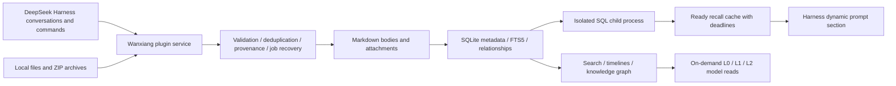

<p align="center">
  
</p>

<h1 align="center">Wanxiang Knowledge · 万象知识库</h1>

<p align="center"><a href="README.md">简体中文</a> · English</p>

<p align="center"><strong>Make DeepSeek Harness your personal agent, growing alongside you without limits!</strong></p>

<p align="center">
  <a href="https://github.com/Minglink/wanxiang-knowledge/releases"></a>
  <a href="LICENSE"></a>
  
  
</p>

<p align="center">
  <a href="#installation">Install</a> · <a href="#using-wanxiang-in-harness">Usage</a> · <a href="#memory-retrieval">Memory retrieval</a> · <a href="#measured-performance">Performance</a> · <a href="#architecture-and-data">Architecture</a> · <a href="docs/测试报告.md">Test report (Chinese)</a>
</p>

Wanxiang Knowledge is a community plugin for [DeepSeek Harness](https://github.com/deepseek-ai/deepseek-harness). It turns conversations and project material into reusable local knowledge, with conversation archiving, local search, optional automatic recall, a knowledge graph, a tool catalog, and folder learning. Your current AI can use `/wanxiang` to search existing knowledge and read summaries, full text, or project timelines as needed.

The current release is **0.2.0-alpha.8 (preview)**, primarily tested on Windows with Harness Desktop `0.2.1-alpha.1`. Plugin source code is MIT-licensed. The author's knowledge-library links will also be shared here; the main focus is reverse engineering, and community members are welcome to share their own libraries.

## Using Wanxiang in Harness


Screenshots show a real workspace with imported knowledge and configured tools. Entry, relationship, and available-tool counts depend on local data and configuration. Installing the plugin does not install every tool shown. The screenshots currently show the Chinese interface; this English README does not imply an English UI is available.

| What you want to do | How Wanxiang helps |
| --- | --- |
| Preserve lessons from a conversation | Select a conversation to generate local notes, methods, pitfalls, and project cards; retain sources and skip duplicates |
| Let your current AI use previous knowledge | Run `/wanxiang <question>` using the current conversation's model and permissions |
| Learn from project material | Send `/wanxiang study` in a folder-bound conversation, or select `/wanxiang-study` from the command menu |
| Import existing notes | Drop or select Markdown, UTF-8 text/source files, folders, ZIP archives, or Wanxiang content packs |
| Explore relationships | Filter, rotate, and locate nodes in sphere/network views; navigate between graph nodes and knowledge details |
| Organize tools | Group tools by category, inspect environment status, and link usage knowledge; discover host tool capabilities separately |

### Query from the current conversation

```text
/wanxiang How can I troubleshoot this error?
```

The command asks the current AI to retrieve information through the plugin's knowledge tools. Without an explicit question, it can use the current conversation's question. It does not switch to another model.


### Folder learning and imports

```text
/wanxiang study
# The slash-command menu also offers /wanxiang-study
```

Folder learning reads supported documents and source files from the current conversation's bound directory, uses the organization model selected in settings, retains file provenance, and updates search and the graph. Failed network/model jobs can be resumed, reusing cached organization results for completed files. Ordinary file imports save content directly without calling a model.


<details>
<summary>Import panel and supported formats</summary>


- Markdown, UTF-8 text, declared source/configuration extensions, folders, and ZIP archives.
- Relative references and Obsidian `[[wikilinks]]`; native content packs validate manifests and SHA-256 hashes.
- Identical content is skipped. Different content with the same ID is preserved separately with reference remapping; manual edits are protected.
- Maximum 2,000 files and 64 MiB per batch; 2 MiB per document/attachment. Encrypted, split, and ZIP64 archives are unsupported.
- PDF, Word, and image files are retained as attachments. PDF/Word text extraction and OCR are not implemented.

</details>

### Archive conversations locally

Completed turns are registered in the pending archive list. Organization starts when you click the local-generation action. Choose AI organization or a model-free raw export. New messages produce separate incremental records rather than overwriting existing notes. The organization model can follow the source conversation or be selected explicitly in settings.


## Memory retrieval

### Chinese-aware search and progressive reading

Search primarily uses local `node:sqlite + FTS5`, with Chinese pre-tokenization, two-character terms, entry-specific `questions[]`, and a local alias table for mixed-language queries, error codes, and natural-language questions. No embedding model is required; vector search is currently **Off**.

| Mode or level | Purpose |
| --- | --- |
| `exact` | Paths, error codes, card IDs, and literal text fragments |
| `hybrid` | Merge exact candidates with FTS results, ranking by title, summary, and question variants |
| `deep` | Search full text and display matching body snippets |
| `L0 → L1 → L2` | Read a short summary first, then an overview, then full text only when needed to control context volume |

Model tools include `knowledge_search`, `knowledge_read`, `knowledge_timeline`, and `tool_catalog_search`. Search returns L0 by default, and body reads have length limits. Entries include stable IDs, provenance, update times, and validity status for verification and traceability.

### Optional automatic recall

Recall has three modes: **Off / Hint only / Automatic injection**. Automatic injection requires explicit confirmation that knowledge summaries will be sent to the host model.

Retrieval runs in a terminable SQL child process, with a 150ms per-slot budget, a 190ms total search budget, and a 200ms outer cache budget. The synchronous prompt section **only reads ready cache entries**: it does not wait for retrieval, read bodies, or call a model. A step is skipped when results are not ready or time out. Logs support inspecting references, marking results useful/unhelpful, and blocking entries or projects.

**Automatic injection remains experimental.** Search-page evaluation and injection-policy evaluation measure different things. At the development threshold of `0.65`, the fixed synthetic policy set has a **76.25% miss rate**. Real-history holdout evaluation and a finalized threshold are still pending. Search Recall@5 must not be treated as injection quality.

<details>
<summary>Model and recall settings</summary>


Files, indexes, and rule-based retrieval stay local. AI organization, folder learning, metadata completion, and confirmed automatic injection send relevant text or summaries to the model configured in Harness. Model-assisted query rewriting is separately optional and disabled by default.

</details>

## Knowledge graph and activity

Sphere and network layouts visualize relationships, with type legends, title/tag filtering, rotation, dragging, reset, and PNG export. Knowledge details and graph nodes support navigation in both directions. Large inputs are aggregated according to thresholds.

Blue nodes briefly turn lemon yellow when a read, archive, or actual injection event is recorded. **Activity means knowledge was accessed, not that the model adopted its conclusions.** The tool catalog is presented separately from the knowledge graph.


## Measured performance

These are local synthetic measurements, not guarantees for every corpus, machine, or model. Reproduction commands, raw JSON, and limitations are in the [performance report (Chinese)](docs/performance.md).

| Measurement | Result | Scope |
| --- | --- | --- |
| Chinese hybrid retrieval | 80 queries, Recall@5 **100%**, MRR **0.98125** | 20 fixed synthetic entries; not a real-history holdout |
| Native FTS, 100,000 entries | p50 **0.75ms**, p95 **85.20ms** | Disk index, including broad terms; excludes model and full service |
| Isolated recall, 100,000 entries | p95 **91.27ms**, 40/40 without timeout | RecallSearch + IPC + rules/confidence, including cold startup |
| Resident Map, 100,000 entries | Heap **716.90 → 181.02 MiB**, about **74.7% lower** | Full-body versus metadata-only retention; not total application memory |
| One-million-entry stress test | FTS p95 **844.68ms**; isolated recall **20/40 timed out** | Exposes broad-query costs and deadline limits |
| Current code verification | Build, type checking, **80/80 tests passed** | Local verification, not compatibility with every host version |

Recall deadlines bound overhead by abandoning timed-out injection. They do not guarantee successful retrieval at every scale. The two scale benchmark suites ran concurrently on the same Windows machine with Node.js v24.19.0, so contention may affect results.

## Architecture and data



| Design choice | Benefit and tradeoff |
| --- | --- |
| Native Harness plugin | Integrates conversations, commands, tools, and prompt extension points within the host |
| Markdown as the body source | Read, edit, and back up files directly; rebuild indexes without locking knowledge inside a database |
| Native SQLite + FTS5 | Persistent local search; falls back to sql.js when unavailable, with scale warnings |
| On-demand body loading | Keep mostly metadata in the resident Map to reduce JavaScript heap usage |
| SQL process isolation | Terminate timed-out queries at the cost of cold startup and additional process memory |
| Sharding, revisions, and publication manifests | Organize notes by month and cards by project; support recovery, conflict rejection, and reorganization undo |
| Progressive disclosure and provenance | Send summaries before full text and retain sources that can be checked |

Top-level compatibility copies support older readers and consume additional disk space. Conflicting edits on both sides are not silently overwritten. Reorganization and undo perform preflight checks and backups; this does not guarantee recovery from every possible power failure.

```text
Knowledge directory/
├─ notes/          Conversation notes
├─ cards/          Methods, pitfalls, and project cards
├─ sources/        Conversation excerpts and external sources
├─ attachments/    Imported attachments
├─ tools/          Tool catalog and analysis records
└─ .wanxiang/      Indexes, jobs, revisions, recall logs, and aliases
```

## Tool catalog and analysis extensions

The catalog groups registered tools by category and shows environment checks and linked knowledge. Green indicates detected availability. Registration and environment availability are separate states: an exposed interface does not mean its dependencies are installed.

Optional security-analysis extensions cover PE/ELF, disassembly, strings, existing traffic files, APK/DEX, .NET, YARA, and related tasks. **These components require additional installation and configuration; the plugin package does not bundle all tools.** See [security tools documentation (Chinese)](docs/security-tools.md) for interfaces, setup, and operating limits.


## Installation

### Install a plugin package

Download `dsh-wanxiang-knowledge-0.2.0-alpha.8.tgz` from [GitHub Releases](https://github.com/Minglink/wanxiang-knowledge/releases) and select it through Harness's local plugin-package installation entry. The [same package](artifacts/dsh-wanxiang-knowledge-0.2.0-alpha.8.tgz) is also stored in this repository. Before upgrading, wait for host conversations and background jobs to finish, and back up your knowledge directory.

For a standard Web profile, this host version supports:

```powershell
dsh plugin --profile web add "<absolute-path-to-plugin-package>"
```

### Build from source

```powershell
git clone https://github.com/Minglink/wanxiang-knowledge.git
cd wanxiang-knowledge
npm ci
npm run build
npm run typecheck
npm test
npm run pack:plugin
```

The default knowledge directory is `万象知识库` under your Documents folder and can be changed in settings. Plugin settings are stored at `<DSH_HOME>/wanxiang/settings.json`. The desktop development installer also requires `WANXIANG_HOST_URL` pointing to your local Harness instance to check idle conversations/jobs and create a complete backup; see the [installer](scripts/install-desktop.mjs).

## Optional knowledge content packs

[knowledge/](knowledge/README.md) provides **1,182 knowledge entries**, covering reverse-engineering foundations, vulnerability mechanisms, systems internals, virtual machines, cryptography, and technical documentation from pinned OpenSSL, LLVM/Clang, and QEMU versions. Chinese explanatory notes and English source documents are identified separately, with provenance, hashes, and applicable licenses retained.

Installing the plugin does not automatically import these packs into your personal library. Select a pack folder in the import panel, or run:

```powershell
node scripts/import-reverse-knowledge.mjs --root "<absolute-knowledge-directory>" --source "<absolute-content-pack-directory>"
```

Duplicates are skipped and conflicting overwrites are rejected. Inclusion and structural validation do not mean every document's code has been tested.

## Current limitations and contributions

- Primarily validated on Windows + Harness Desktop `0.2.1-alpha.1`; other platforms and host versions need further testing.
- No vector retrieval, OCR, PDF/Word text extraction, cloud synchronization, or multi-user collaboration yet.
- Real-history automatic recall quality, a finalized threshold, and production first-step coverage remain unevaluated. A complete million-entry Markdown/application pipeline has not been validated.
- Model-organized conclusions need source verification. Analysis extensions are not a malware sandbox.

Report reproducible problems through [Issues](https://github.com/Minglink/wanxiang-knowledge/issues), or contribute improvements to retrieval, visualization, and compatibility through pull requests. Use sanitized minimal examples; do not upload private conversations, credentials, or business samples.

## Community

- Red Team Security Discussion — QQ Group 11: `1043279187`
- Tencent QQ Channels technical community: `pd86424753`

## License and acknowledgments

Plugin source code is licensed under [MIT](LICENSE). Third-party documents in `knowledge/` retain their individual and bundled licenses. DeepSeek, DeepSeek Harness, and third-party tool names belong to their respective owners. This is a community-maintained project.
