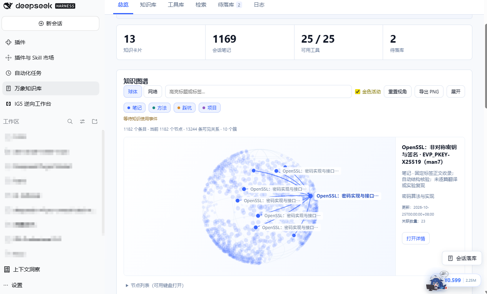
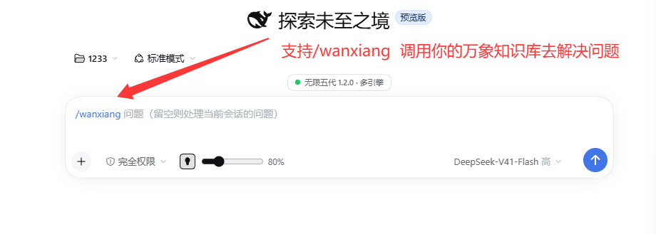
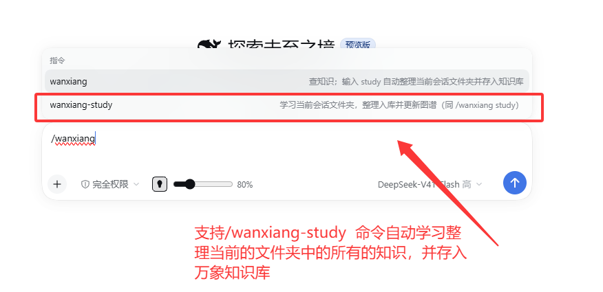
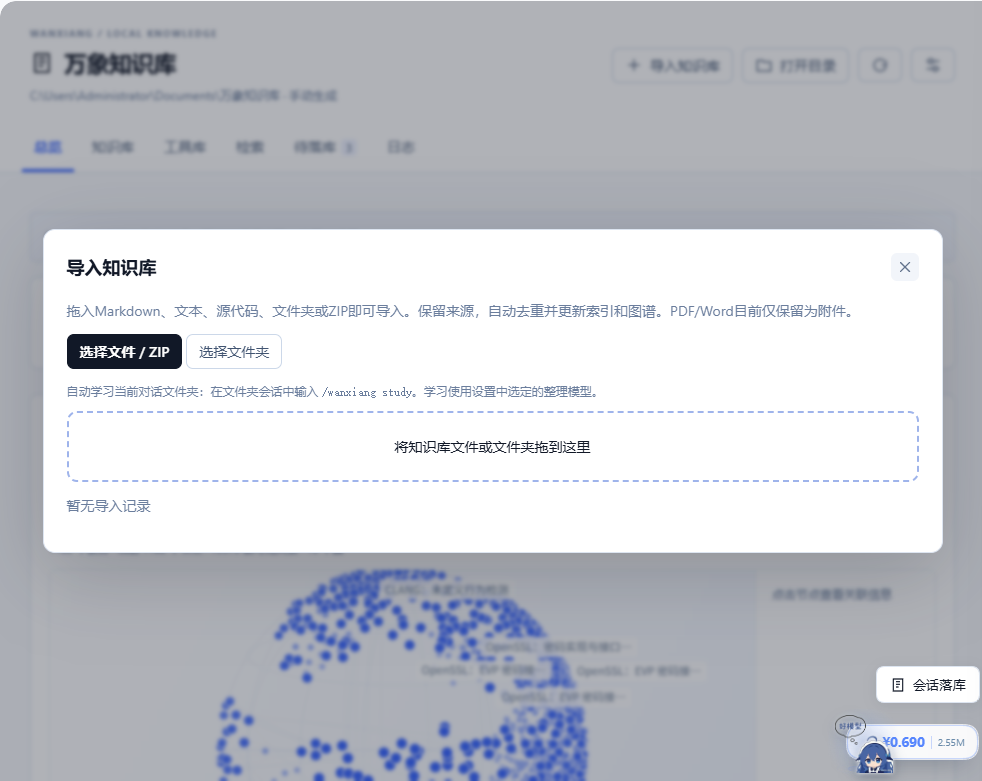
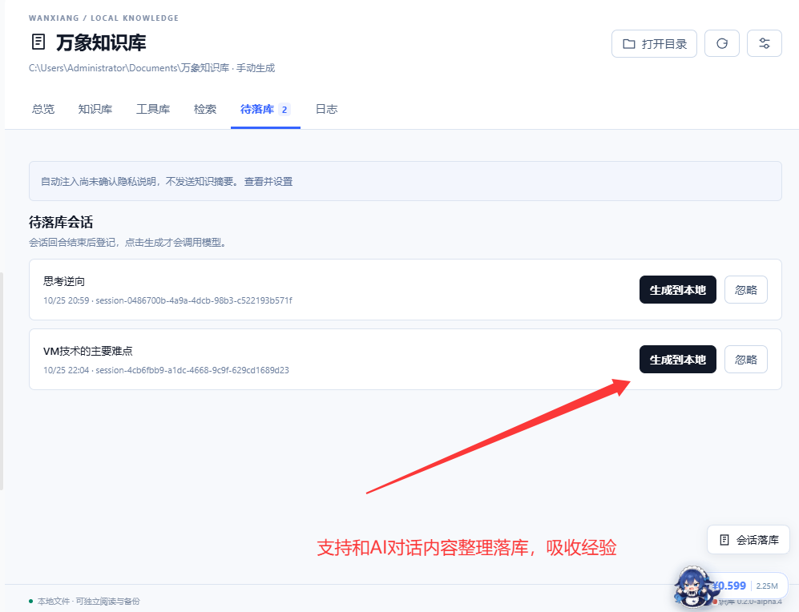
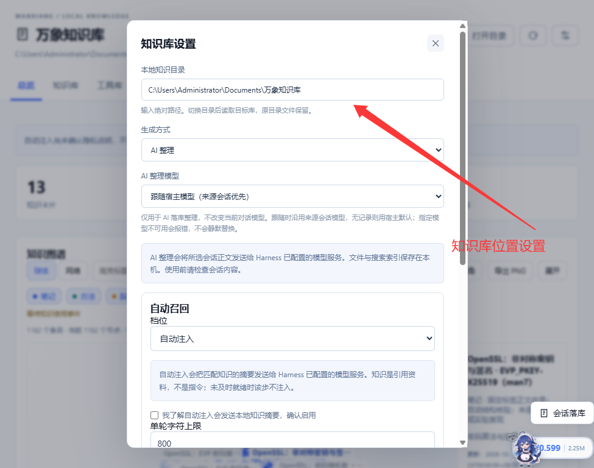
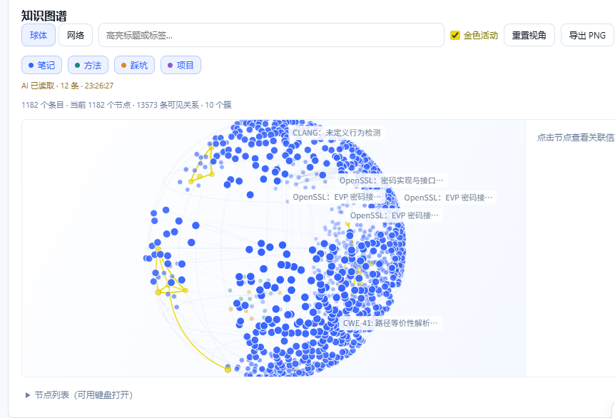
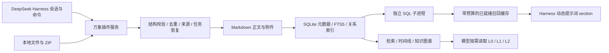
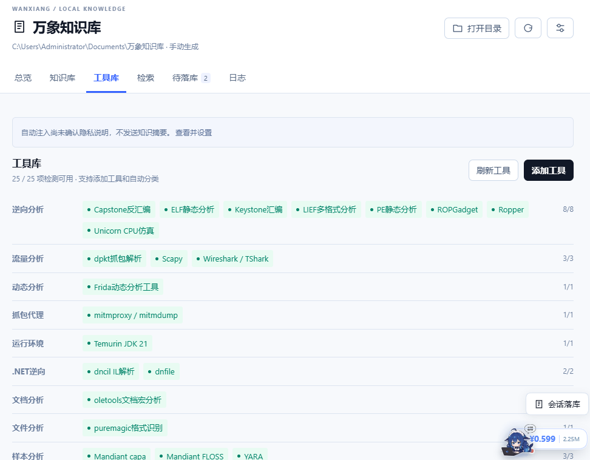

<p align="center">
  
</p>

<h1 align="center">万象知识库</h1>

<p align="center">让你的<strong>DeepSeek Harness成为你的专属Agent，陪你一起无限进步！</strong></p>

<p align="center">
  <a href="https://github.com/Minglink/wanxiang-knowledge/releases"></a>
  <a href="LICENSE"></a>
  
  
</p>

<p align="center">
  <a href="#快速安装">安装</a> · <a href="#在-harness-中使用">使用</a> · <a href="#记忆检索">记忆检索</a> · <a href="#性能实测">性能</a> · <a href="#架构与数据">架构</a> · <a href="docs/测试报告.md">测试报告</a>
</p>

万象知识库是为 [DeepSeek Harness](https://github.com/deepseek-ai/deepseek-harness) 开发的社区插件。它在 Harness 内提供会话落库、本地检索、可选自动召回、知识图谱、工具目录和文件夹学习：当前 AI 可以通过 `/wanxiang` 查询已有知识，也可以按需读取摘要、正文和项目时间线。

当前版本为 **0.2.0-alpha.8 预览版**，主要验证环境是 Windows + Harness Desktop `0.2.1-alpha.1`。插件代码采用 MIT 许可证；可选知识内容包保留各来源的署名和许可。本项目由社区维护。

## 在 Harness 中使用



截图展示的是已导入知识和配置了工具环境的实际工作台；条目数、关系数和可用工具数随本地数据变化，安装插件不会自动获得截图中的全部工具。

| 你要做的事 | 万象如何完成 |
| --- | --- |
| 留下这次讨论的经验 | 选中会话，一键生成笔记、方法、踩坑和项目卡片；记录来源，重复内容跳过 |
| 让当前 AI 使用以前的知识 | 输入 `/wanxiang 问题`，保持当前会话模型和权限，由 AI 查询知识后回答 |
| 学习项目资料 | 在绑定文件夹的会话发送 `/wanxiang study`，或从菜单选择 `/wanxiang-study` |
| 导入已有笔记 | 拖入或选择 Markdown、UTF-8 文本/源代码、文件夹、ZIP 或万象内容包 |
| 找到知识之间的关系 | 在球体/网络图谱中筛选、旋转、定位节点，双向跳转到正文 |
| 管理常用工具 | 按类别登记工具、查看环境检测状态、关联使用方法；宿主工具能力另行发现 |

### 当前会话查询

```text
/wanxiang 如何排查这个错误？
```

命令把查询交给当前 AI，通过插件提供的知识工具获取资料。省略问题时可结合当前会话问题查询，不额外切换模型。



### 文件夹学习与导入

```text
/wanxiang study
# 斜杠菜单也可选择 /wanxiang-study
```

学习当前会话绑定目录中的支持文档与源代码，使用设置里选择的整理模型，保留文件来源，完成后更新检索和图谱。网络或模型失败可以继续，已完成文件的整理缓存会复用。普通文件导入直接保存内容，不调用模型。



<details>
<summary>查看导入面板与支持范围</summary>



- 支持 Markdown、UTF-8 文本与声明的源代码/配置扩展名、文件夹和 ZIP。
- 支持相对引用与 Obsidian `[[双向链接]]`；原生内容包校验清单及 SHA-256。
- 相同内容跳过，同 ID 不同内容保留两份并映射引用，保留手工修改。
- 单批最多 2000 文件、64 MiB；单文档/附件最多 2 MiB。不支持加密 ZIP、分卷和 ZIP64。
- PDF、Word 和图片目前作为附件保留，不提取 PDF/Word 正文，也不提供 OCR。

</details>

### 会话落库

回合结束后登记到「待落库」，点击「生成到本地」才开始整理。可选 AI 整理或无需模型的原文导出；会话新增消息生成独立增量记录，不覆盖旧笔记。AI 整理模型可跟随来源会话，也可在设置里明确选择。



## 记忆检索

### 中文召回与渐进读取

检索以本地 `node:sqlite + FTS5` 为主，结合中文预分词、两字词、条目问法 `questions[]` 与本地别名表，补强中英混合、错误码和自然语言问法。没有嵌入模型依赖，当前向量检索为 **Off**。

| 模式或层级 | 适用场景 |
| --- | --- |
| `exact` 精确检索 | 路径、错误码、卡片 ID 和原文片段 |
| `hybrid` 混合检索 | 精确候选与 FTS 结果融合，利用标题、摘要和问法排序 |
| `deep` 深度检索 | 扩展到正文，显示正文命中片段 |
| `L0 → L1 → L2` | 先读短摘要，再读概览，最后按需读取正文，控制上下文体积 |

模型工具包括 `knowledge_search`、`knowledge_read`、`knowledge_timeline` 和 `tool_catalog_search`。搜索默认返回 L0，正文读取有长度上限；条目附稳定 ID、来源、更新时间和有效状态，便于核对和追溯。

### 可选自动召回

自动召回提供 **关闭 / 仅提示 / 自动注入** 三档。自动注入必须先确认知识摘要会发送给宿主模型；未确认时不开始注入。

检索在可终止的独立 SQL 子进程中运行。单槽预算 150ms、搜索总预算 190ms、缓存外层预算 200ms；同步提示词 section **只读取已就绪缓存**，不等待检索、不读取正文、不调用模型。未就绪或超时就跳过该步，优先保证会话继续。日志支持查看引用、反馈有用/无用，以及屏蔽条目或项目。

**当前自动注入仍属实验能力。** 检索页合成评测与自动注入策略是不同口径：开发阈值 `0.65` 在固定合成策略集上的漏召率为 **76.25%**，真实历史留出评测与正式阈值尚未完成，不能用检索页 Recall@5 替代自动注入质量。

<details>
<summary>查看模型与召回设置</summary>



文件、索引和规则检索保存在本机。AI 整理、文件夹学习、元数据补全和经确认的自动注入会按所选功能将相关文本或摘要发给 Harness 配置的模型；智能查询改写是独立可选项，默认关闭。

</details>

## 知识图谱与活动

球体与网络两种布局展示知识关系；支持类型图例、标题/标签筛选、旋转、拖拽、重置和导出 PNG。知识详情与图谱可以双向定位，大规模输入会按阈值聚合。

蓝色知识节点在发生已记录的读取、落库或实际注入时短暂变为柠檬黄。**活动表示知识被访问，不表示模型已经采纳结论。** 工具目录与知识图谱分开呈现。



## 性能实测

性能报告同时给出范围和代价：下面是本机合成数据测量，不是所有资料、机器或模型的性能承诺。复现命令、原始 JSON 与局限见 [性能与架构说明](docs/performance.md)。

| 实测项目 | 结果 | 测量范围 |
| --- | --- | --- |
| 中文混合检索合成评测 | 80 个查询，Recall@5 **100%**，MRR **0.98125** | 20 条固定合成知识，非真实历史留出集 |
| 10 万条原生 FTS 查询 | p50 **0.75ms** / p95 **85.20ms** | 原生磁盘索引，含宽泛词；不含模型和完整服务 |
| 10 万条隔离自动召回 | p95 **91.27ms**，40/40 未超时 | RecallSearch + IPC + 规则/置信度，含冷启动 |
| 10 万条驻留 Map | 堆内存 **716.90 → 181.02 MiB**，约降低 **74.7%** | 全正文与仅元数据两种驻留方式；非应用总内存 |
| 百万条压力测试 | FTS p95 **844.68ms**；隔离召回 **20/40 超时** | 用于暴露宽泛检索和预算限制，不宣称百万规模无损召回 |
| 当前代码验证 | 构建、类型检查、**80/80 测试通过** | 本机验证，不代表所有宿主版本均兼容 |

自动召回的截止预算用于限制开销，超时会放弃注入，不能把「预算 200ms」理解为任何规模都能成功检索。百万规模、宽泛词与冷启动的成本会在性能说明中一并展示。

## 架构与数据



| 架构选择 | 实际收益与边界 |
| --- | --- |
| 原生 Harness 插件 | 接入会话、命令、工具与提示词扩展点，在宿主内完成查询和沉淀 |
| Markdown 是正文来源 | 可以直接阅读、编辑与备份；索引可删除重建，知识不锁在数据库内 |
| 原生 SQLite + FTS5 | 本地持久检索；能力缺失自动降级到 sql.js，并提示规模限制 |
| 正文按需加载 | 常驻 Map 主要保留元数据，减少大正文的 JS 堆占用 |
| SQL 子进程隔离 | 超时后终止查询进程；代价是冷启动和额外进程内存 |
| 分片、修订与发布清单 | 笔记按年月、卡片按项目组织；支持异常恢复、冲突拒绝和整理撤销 |
| 渐进披露与来源标识 | 先摘要再正文，控制送入模型的内容量，并保留可核对的来源 |

新版本维护顶层兼容副本供旧版读取，副本会增加磁盘占用；两侧内容同时修改时拒绝静默覆盖。目录整理与撤销前先预检、备份，不能据此保证任意断电情况下都可恢复。

```text
知识目录/
├─ notes/          会话笔记
├─ cards/          方法、踩坑与项目卡片
├─ sources/        会话摘录与外部来源
├─ attachments/    导入附件
├─ tools/          工具目录与分析记录
└─ .wanxiang/      索引、任务、修订、召回日志及别名配置
```

## 工具库与分析扩展

工具库按类别显示登记的工具、环境检测状态和知识关联。绿色表示检测可用，注册状态与环境状态独立显示，不能把「存在接口」当作「环境已安装」。

可选安全分析扩展接入 PE/ELF、反汇编、字符串、已有流量文件、APK/DEX、.NET、YARA 等能力。**这些组件需要额外安装与配置，不随插件安装包捆绑全部工具。** 具体接口、安装方法和运行边界见 [安全分析工具库](docs/security-tools.md)。



## 快速安装

### 安装插件包

从 [GitHub Releases](https://github.com/Minglink/wanxiang-knowledge/releases) 下载 `dsh-wanxiang-knowledge-0.2.0-alpha.8.tgz`，在 Harness 的本地插件包安装入口选择该文件。仓库也保留 [同版本安装包](artifacts/dsh-wanxiang-knowledge-0.2.0-alpha.8.tgz)。升级前请等待宿主会话和后台任务结束，并备份知识目录。

普通 Web profile 可使用该版本宿主的插件管理命令：

```powershell
dsh plugin --profile web add "<插件包绝对路径>"
```

### 从源码构建

```powershell
git clone https://github.com/Minglink/wanxiang-knowledge.git
cd wanxiang-knowledge
npm ci
npm run build
npm run typecheck
npm test
npm run pack:plugin
```

默认知识目录为用户 Documents 下的「万象知识库」，可在设置中切换。插件设置保存于 `<DSH_HOME>/wanxiang/settings.json`。桌面开发安装脚本还要求设置 `WANXIANG_HOST_URL` 为本机 Harness 地址，以核对会话/任务空闲并完整备份；见 [安装脚本](scripts/install-desktop.mjs)。

## 可选知识内容包

[knowledge/](knowledge/README.md) 提供 **1182 条知识正文**，包括逆向基础、漏洞机制、系统底层、VM、密码算法，以及固定版本的 OpenSSL、LLVM/Clang、QEMU 技术文献。中文机制归纳与英文文献正文分别标注，来源、哈希和适用许可随内容保留。

内容包不会在安装插件时自动写入你的个人库。可从「导入知识库」选择内容包文件夹，或使用 `scripts/import-reverse-knowledge.mjs --root <知识库绝对路径> --source <内容包绝对路径>`；重复内容跳过，冲突拒绝覆盖。文献收录和结构校验不等于逐篇代码实测。

## 当前边界与参与

- 当前主要验证 Windows + Harness Desktop `0.2.1-alpha.1`，其他平台/宿主版本需进一步测试。
- 尚无向量检索、OCR、PDF/Word 正文解析、云同步或多用户协作。
- 自动召回的真实历史质量、正式阈值与生产首步覆盖率仍待评测；百万条完整 Markdown 与应用全链路性能尚未验收。
- 模型整理的结论需要结合来源核验；分析扩展也不是恶意样本沙箱。

欢迎通过 [Issues](https://github.com/Minglink/wanxiang-knowledge/issues) 提交可复现问题，或提交改进检索、图谱与兼容性的 PR。请使用脱敏的最小示例，不上传私人会话、凭据或业务样本。

## 许可与致谢

插件源码采用 [MIT](LICENSE)。`knowledge/` 中第三方文献遵循各条目及随附许可；DeepSeek、DeepSeek Harness 和第三方工具名称归各自权利人所有。封面为 AI 生成的社区项目宣传图，界面配图由项目维护者提供。
